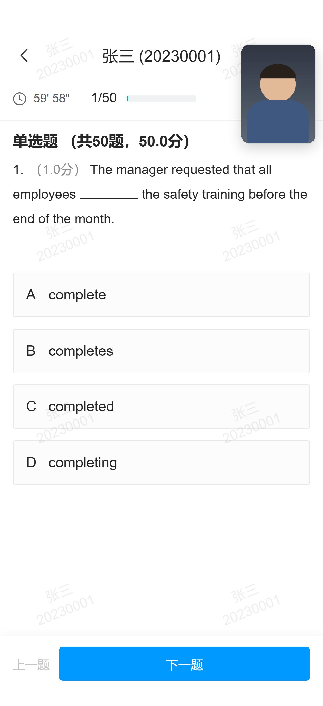
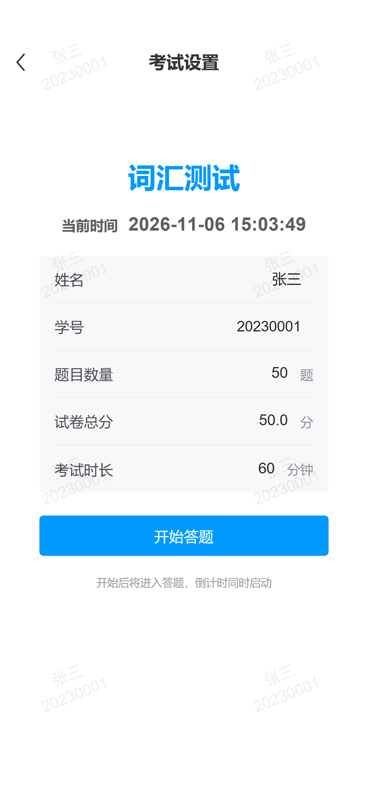
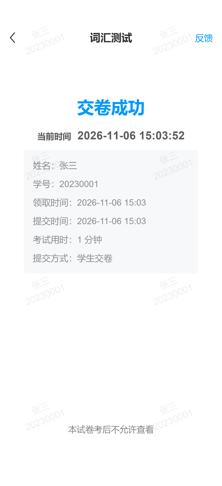

# 学习通 · 答题页（纯前端复刻）

按 `docs/答题页布局说明.md` 的实测数据 1:1 还原的静态页面，**无后端、无构建、无依赖**。



## 运行

直接双击 `index.html` 即可（`file://` 协议下也正常工作）。

如果想用本地服务器：

```bash
# 任选其一
python -m http.server 8000
npx serve .
```

然后访问 `http://localhost:8000`。

## 文件

| 文件 | 说明 |
| --- | --- |
| `index.html` | 页面结构（导航栏 / 信息条 / 内容 / 底部栏 / 答题卡面板 / 水印 / 结果页） |
| `styles.css` | 全部样式，顶部 `:root` 是设计令牌（颜色 + 尺寸） |
| `app.js` | 50 道 mock 题、选中逻辑、切题、倒计时、答题卡 |
| `preview.png` | 1260 × 2751 渲染截图 |

## 尺寸基准

参考图 `参考图/questions.jpg` 为 **1260 × 2750 px**，按 **3×** 屏换算：

```
CSS 视口 420 × 917 px
所有 CSS px = 参考图物理像素 ÷ 3
```

- 桌面端：以 420 × 917 的手机外框居中显示；窗口高度不足时自动等比缩放（`fitFrame()`），不会出现滚动条
- 手机端：`width:100%` + `100dvh` 铺满，底部自动叠加 `env(safe-area-inset-bottom)`

## 还原精度

用无头 Chrome（`--force-device-scale-factor=3`，视口 420 × 917）渲染后与参考图逐像素比对，关键锚点偏差（单位：参考图物理像素）：

| 元素 | 参考图 | 实现 | 偏差 |
| --- | --- | --- | --- |
| 分割线 y | 468 | 468 | 0 |
| 题型标题首行 ink-y | 526 | 526 | 0 |
| 题干首行 ink-y | 707 | 712 | +5 |
| 选项 A 顶边 | 1226 | 1226 | 0 |
| 选项 A 字母左缘 x | 102 | 102 | 0 |
| 选项 A 文字左缘 x | 192 | 193 | +1 |
| 信息条时钟 x | 52 | 52 | 0 |
| 题号 `3/50` 左缘 x | 356 | 356 | 0 |
| 进度条左缘 x | 494 | 494 | 0 |
| 答题卡图标 x / y | 1059 / 327 | 1059 / 328 | 0 / +1 |
| 返回箭头 x / y | 81 / 191 | 80 / 189 | −1 / −2 |
| 导航标题左缘 x | 334 | 336 | +2 |
| 上一题文字左缘 x | 12 | 50 | +38（中文版把底部栏留白改回 16.67px，见「中文化」） |
| 下一题按钮顶边 y | 2519 | 2520 | +1 |

即：**垂直方向卡点全部命中，剩余偏差 ≤ 2 px（< 1 CSS px），来源是字体度量差异**。

## 已实现的交互

| 区域 | 行为 |
| --- | --- |
| 选项卡片 | 单选；点已选项可取消；切换时颜色过渡 120 ms |
| 上一题 | 上一题；第 1 题禁用（置灰） |
| 下一题 | 下一题；第 50 题变为 **交卷**（交卷后进入结果页） |
| 计时器 | 从 59' 29" 开始每秒递减，格式 `59' 29"` |
| 进度条 | 填充宽度 = `当前题 / 总题数`，250 ms 过渡（3/50 时是一小段，不是圆点） |
| 答题卡 | 打开答题卡面板：50 格，当前题实心蓝、已答浅蓝、未答灰；点击格跳题 |
| 键盘 | `←` `→` 切题，`Esc` 关闭面板 |

## 数据

`app.js` 顶部：

```js
const POOL = [ ... ];                    // 12 道题，第 3 项是参考图原题
const DEFAULTS = { count: 50, score: 50.0, minutes: 60 };  // 设置页默认值
const LIMITS   = { count: [1,100], score: [1,1000], minutes: [1,300] };
```

题量、总分、时长都由**开始页**决定，运行时存在 `state` 里：

```js
state.total      // 题量（驱动 n/N、进度条、答题卡格数）
state.totalScore // 总分（驱动「共 N 题，X 分」）
state.minutes    // 考试时长（倒计时起点）
state.questions  // 开考时按题量生成：按 i % 12 循环取题，每题分值 = 总分 / 题数
```

题目池只有 12 道，题量大于 12 时会循环复用 —— 演示用，接后端时把 `buildQuestions()` 换成接口数据即可。

## 开始页（v1.7）

进入页面先是一个设置页：**姓名 / 学号 / 题目数量 / 试卷总分 / 考试时长**，点「开始答题」才进入答题。

| 项 | 默认 | 范围 | 作用 |
| --- | --- | --- | --- |
| 姓名 | 空（占位「请输入姓名」） | ≤ 20 字 | 答题页标题、结果页「姓名」行、水印 |
| 学号 | 空（占位「请输入学号」） | ≤ 20 字 | 同上（标题里显示为 `姓名 (学号)`） |
| 题目数量 | 50 | 1–100 | 题量，同步到 `n/N`、进度条、答题卡 |
| 试卷总分 | 50.0 | 1–1000 | 题型标题「共 N 题，X 分」，每题分值 = 总分 ÷ 题数 |
| 考试时长 | 60 分钟 | 1–300 | 倒计时起点，归零自动交卷 |

- **姓名 / 学号不写死**：页面上没有任何硬编码，全部来自输入框；空着点「开始答题」会被拦下并提示
- 数字输入会被规范化并回写（超出范围自动夹到边界，总分保留 1 位小数）
- 输入姓名/学号时，背景水印实时跟着变
- 点「开始答题」后才申请摄像头；交卷或返回设置页时释放
- 交卷结果页点「返回」回到设置页，可以重新配置再考一次



## 与参考图的已知差异

| # | 差异 | 原因 / 说明 |
| --- | --- | --- |
| 1 | 字形宽度略有出入（选项文本宽 3%–8%） | 参考图是 Android 的 **Roboto**；本机回退到 Arial / 微软雅黑，字高一致但字宽不同 |
| 2 | 描边略粗（3 物理 px vs 参考 2 px） | CSS `1px` 在 3× 屏渲染为 3 物理像素；若要更细可改 `0.67px`（部分浏览器会吃掉亚像素） |
| 3 | 题干断行 | 参考图第 2 行是「the ______ that…」，实现中用 `.nw`（nowrap）+ `.blank` 固定，确保断行位置一致 |
| 4 | 填空下划线 | 参考图的 6 个下划线字符宽度不一，改用 76 × 1.4 px 的 `.blank`（底边框）精确还原 |
| 5 | 答题卡面板 | 参考图未展示，按同一套设计语言（主色 + 卡片语汇）补全 |
| 6 | 底部栏「上一题」改为左右各 16.67 px 留白、与按钮间距 12 px | 英文版照抄了参考图把「Previous question」贴到屏幕左缘的排版缺陷；中文文案只剩 3 个字，贴边会很难看，故改为正常留白 |

## 修正版（可选）

参考图的排版缺陷（全篇 justify 的大词距、底部栏左右留白不对称、信息条右侧未对齐）在 `styles.css` 末尾留了修正规则，给 `<body>` 加 `class="clean"` 即切换：

```html
<body class="clean">
```

效果：题干/标题改为左对齐、底部栏恢复 16.67 px 内边距、答题卡入口对齐内容右边界。

## 进度条（v1.1 修正）

第一版按 `questions.jpg` 的 3/50 判断为「圆点指示器」——**这是错的**。拿到 `question-2.jpg`（16/50）与 `questions-3.jpg`（36/50）后发现它是**填充条**：

```
轨道 270 × 26 px，圆角 8 px，#F0F1F3
填充  = n / 50 × 270，同高、左对齐、同样圆角，#0099FF
```

| 截图 | 题号 | 填充实测 | n/50 × 轨道 |
| --- | --- | --- | --- |
| questions.jpg | 3/50 | 17 px | 16.2 px |
| question-2.jpg | 16/50 | 86 px | 86.4 px |
| questions-3.jpg | 36/50 | 194 px | 194.4 px |

3/50 时填充只有 17 px 宽（比 26 px 的高度还窄），所以看起来像个小圆点——这正是当初误判的原因。

实现：`.ib-progress`（轨道）+ `.ib-progress__fill`（填充），`width` 由 JS 按比例设置，`transition: width .25s`。

## 中文化（v1.2）

界面文案按 `参考图/question-ch.jpg` 换成中文，不提供语言切换：

| 位置 | 英文版 | 中文版 |
| --- | --- | --- |
| 题型标题 | Single Choice ( total50question , 50.0score) | 单选题 （共50题，50.0分） |
| 题干前缀 | (1.0score) | （1.0分） |
| 答题卡入口 | Answer Card | 答题卡 |
| 上一题 | Previous question | 上一题 |
| 下一题 | Next question | 下一题 |
| 最后一题 | Submit | 交卷 |
| 答题卡标题 | Answer Card | 答题卡 |
| 图例 | Answered / Current / Unanswered | 已答 / 当前 / 未答 |
| 计时 | 59' 29" | 59' 29"（分钟补零，如 05' 46"） |

题型标题和总分由数据算出来（`TOTAL` / `TOTAL_SCORE`），不写死。

**为中文做的两处排版调整**

1. **题干改为左对齐**：`（1.0分）` 前缀比 `(1.0score)` 短很多，`text-align: justify` 会把「3.」和「（1.0分）」之间的空格拉到 40 px 以上。英文版那份参考图本身就是这种 justify 排版（已记录为缺陷），中文化时按 `docs/答题页布局说明.md` §7 的建议改成了左对齐。
2. **底部栏恢复常规留白**：英文版「Previous question」贴左缘是原实现的 bug；中文只剩 3 个字，贴边更明显，改为 `padding: 0 16.67px` + `gap: 12px`。

## 交卷结果页（v1.3）

点第 50 题的「交卷」后进入，按 `参考图/finished.jpg` 还原，详细拆解见 **[docs/交卷结果页说明.md](../docs/交卷结果页说明.md)**。



**一个关键发现**：`finished.jpg` 顶部没有状态栏，一开始以为结果页是全屏无状态栏的。但把两张图的 Home Indicator 一对比就能确定——

```
答题页 2750 px，指示条在 2711–2725
结果页 2596 px，指示条在 2557–2571
差值正好 154 px（≈ 51 CSS px = 状态栏高度）
```

所以结果页截图只是**把状态栏那一截剪掉了**——两页其实是同一条状态栏。

不过状态栏的**内容**是手机系统画的，页面上不画：删掉了最初自绘的「14:56 + 5G + 电量」，但**那 50 px 的留白保留**——`.app { padding-top: max(50px, env(safe-area-inset-top, 0px)) }`，刘海屏自动取更大的安全区高度。

| 元素 | 规格 |
| --- | --- |
| 导航栏 | 高 42；返回 11×20 折线；标题「词汇测试」20/600；右侧「反馈」16.5 蓝色 |
| 交卷成功 | 32 px / 700 / `#0099FF`，居中，距导航栏底 96 |
| 当前时间 | 标签 16/600 + 时间 21/600，同为 `#5E5E5E`，基线对齐、整行居中 |
| 信息卡 | 左右 44.67 边距、圆角 4、底色 `#F7F8FA`、6 行 × 35 px、文字 16.7 `#8E8E93` |
| 底部说明 | 16.2 / `#86868B`，居中，距底约 99 |

**数据是活的**：领取时间 = 页面加载时刻，提交时间 = 点交卷时刻，考试用时 = 两者差值（至少 1 分钟），「当前时间」每秒刷新。返回键在演示里做「重新开始」（重置作答、回到第 1 题）。

渲染校验：与世界坐标对齐后，导航/标题/时间行/卡片/底部说明的偏差都在 2 px（< 1 CSS px）以内。

## 全屏水印（v1.4）

参考图整页覆盖着一层斜向平铺的「张三 / 20230001」——之前当成截图水印没做，其实是 App 的常驻覆盖层（三张答题截图的水印相位完全一致，说明不是某一页独有的）。

实测并复刻的参数：

| 属性 | 值 |
| --- | --- |
| 内容 | 第一行姓名、第二行学号（**取自开始页的输入**，不再写死） |
| 旋转 | **-21.5°** |
| 字号 / 行距 | 18 / 23.5 CSS px |
| 平铺间距 | **242 × 236.33** CSS px（= 726 × 709 参考图像素，矩形网格、不交错） |
| 颜色 | `rgba(0,0,0,.068)` → 白底上 `#EEEEEE` |
| 相位 | 实例左上角在 (38.3, 754) CSS px |

实现：`.app` 里一个铺满的 `<div class="watermark">`，背景是一张 SVG 平铺片（内含旋转后的两行文字），`pointer-events: none` 所以不影响作答。层级在内容之上、答题卡面板之下。

平铺片的 SVG 在 `renderWatermark(name, id)` 里按当前考生信息拼出来再转成 data URI，输入框一改就重画。

校验：底部那个水印实例的外框，实现是 `115..399 × 2262..2448`，参考图是 `115..396 × 2262..2447`。

## 前置摄像头小窗（v1.5）

右上角一个 96 × 128（3:4 竖向）的圆角小窗，实时显示前置摄像头画面（镜像，object-fit: cover 裁成竖向），**可拖动**到任意位置。

- **调用**：`navigator.mediaDevices.getUserMedia({ video: { facingMode: 'user' } })`，拿到 MediaStream 后塞给 `<video autoplay muted playsinline>`（iOS 必须 `muted + playsinline` 才能自动播放）
- **拖动**：`pointerdown / pointermove / pointerup` + `setPointerCapture`，位置限制在 App 内（顶部不会盖到状态栏留白），同时监听 `resize` 重新夹取边界
- **镜像**：`transform: scaleX(-1)`（前置自拍惯例）
- **失败兜底**：未授权 / 无设备 / 被占用 / 非安全上下文，分别显示对应文案，**点一下重试**
- **层级**：z-index 15（在内容和水印之上，在答题卡弹层之下）
- **交卷即关闭**：点「交卷」时调用 stop() 停止采集（	rack.stop()）并隐藏小窗；点返回「重新开始」时再 start() 打开

### 摄像头需要安全上下文

浏览器只允许在 **HTTPS** 或 **localhost** 下访问摄像头：

```bash
# 本地起个服务再打开 http://localhost:8000
python -m http.server 8000
```

直接双击 `index.html`（`file://`）时，Chrome 一般会直接给 `NotAllowedError`，小窗会显示「摄像头权限被拒绝 / 点击重试」。

## 设计令牌

全部在 `styles.css` 的 `:root`：

```css
--brand: #0099FF;         /* 主色：按钮 / 进度条 / 选中描边与文字 */
--brand-soft: #F2FBFF;    /* 选中底色 = rgba(0,153,255,.05) 叠白 */
--text-1: #262626;  --text-2: #5A5A5A;  --text-3: #8C8C8C;
--card: #FCFCFC;    --card-line: #E9E9E9;   --divider: #F1F1F1;  --track: #F0F1F3;

--pad: 16.67px;      /* 页面左右留白 50px */
--card-h: 58px;      /* 选项卡片高 174px */
--card-gap: 14.67px; /* 卡片间距 44px */
--card-radius: 2.67px;
--btn-h: 44px;       /* 主按钮高 132px */
```

## 兼容性

Chrome / Edge / Safari / Firefox 近两年版本均可。使用了 `dvh`、`env(safe-area-inset-*)`、`max()`，均带有 `vh` / 默认值回退。
